<p align="center">
  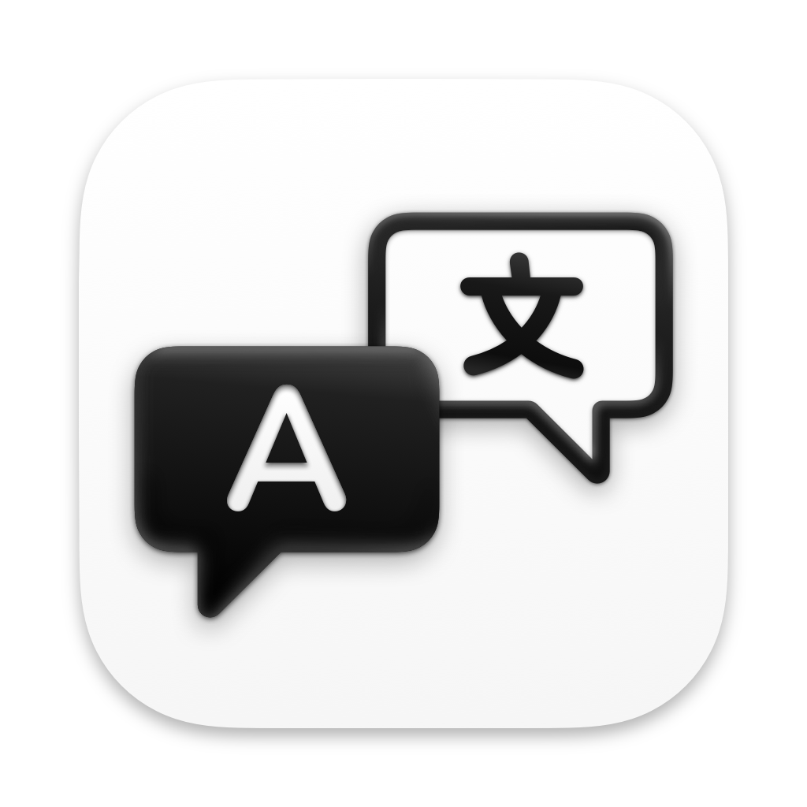
  <h1 align="center">Easydict <sup><sub>for Windows</sub></sup></h1>
  <h4 align="center">Easy to look up words or translate text</h4>
  <p align="center">A Windows port of <a href="https://github.com/tisfeng/Easydict">Easydict</a></p>
</p>

<div align="center">
<a href="./README.md">English</a> &nbsp;&nbsp;|&nbsp;&nbsp; <a href="./README_ZH.md">中文</a>
</div>

<div align="center">

[](https://github.com/xiaocang/easydict_win32/actions/workflows/ci.yml) [](https://www.gnu.org/licenses/gpl-3.0)  [](https://github.com/microsoft/winget-pkgs/tree/master/manifests/x/xiaocang/EasydictforWindows)

<a href="https://apps.microsoft.com/detail/9p7nqvxf9dzj">
  
</a>
<br>
<a href="#install-via-winget">
  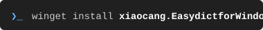
</a>

</div>

## Table of Contents

- [Introduction](#introduction)
- [Screenshots](#screenshots)
- [Features](#features)
- [Installation](#installation)
- [Tech Stack](#tech-stack)
- [Translation Service Integration Tests](#translation-service-integration-tests)
- [Comparison with macOS Version](#comparison-with-macos-version)
- [Support the Project](#support-the-project)
- [License](#license)
- [Acknowledgements](#acknowledgements)

## Introduction

Easydict for Windows brings translation, dictionary lookup, and text tools together with quick keyboard shortcuts and flexible windows.

<p align="right"><a href="#table-of-contents">Back to Top</a></p>

## Screenshots

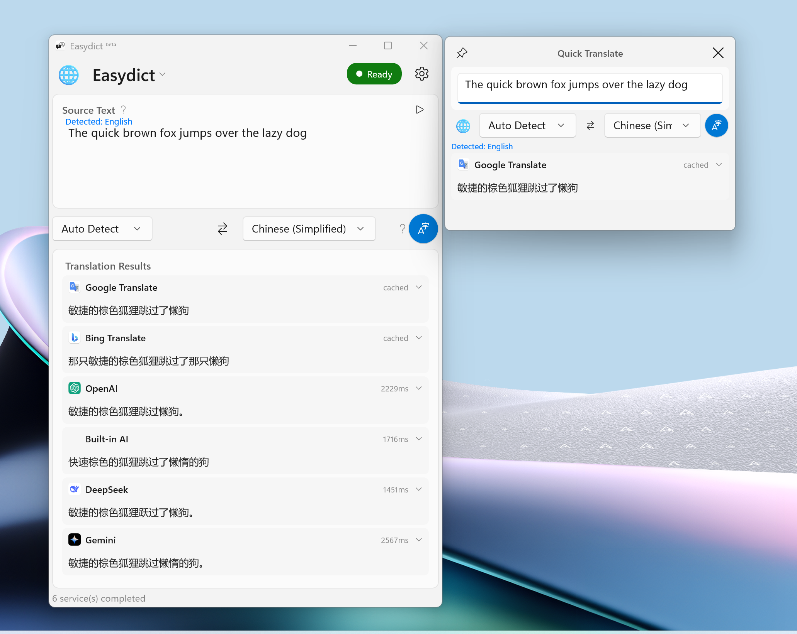

*Main Window with Mini Window (Quick Translate)*

| Main Window | All Windows | Settings |
|-------------|-------------|----------|
| 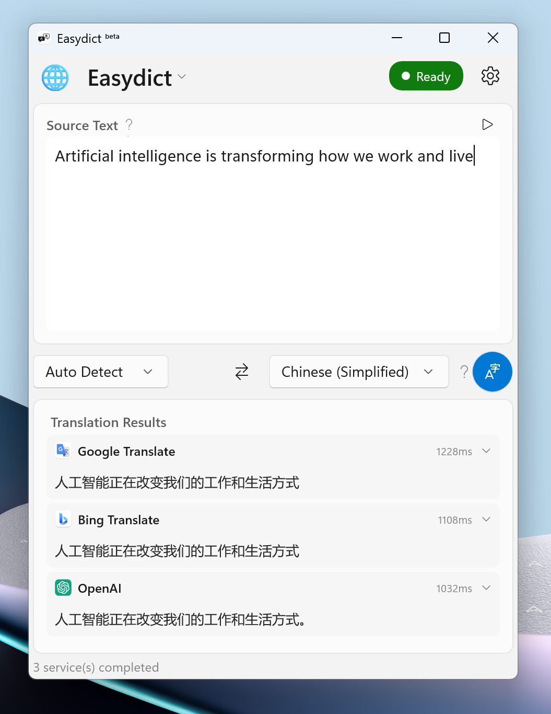 | 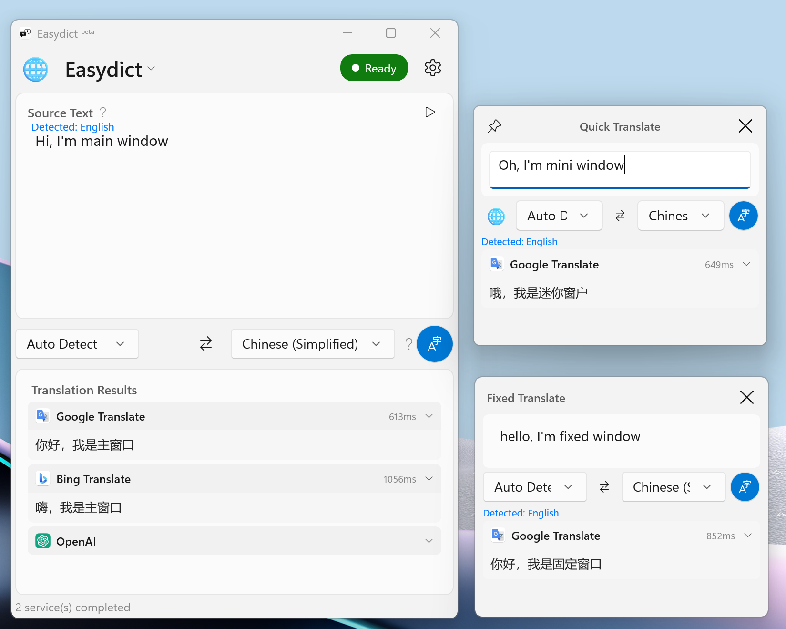 | 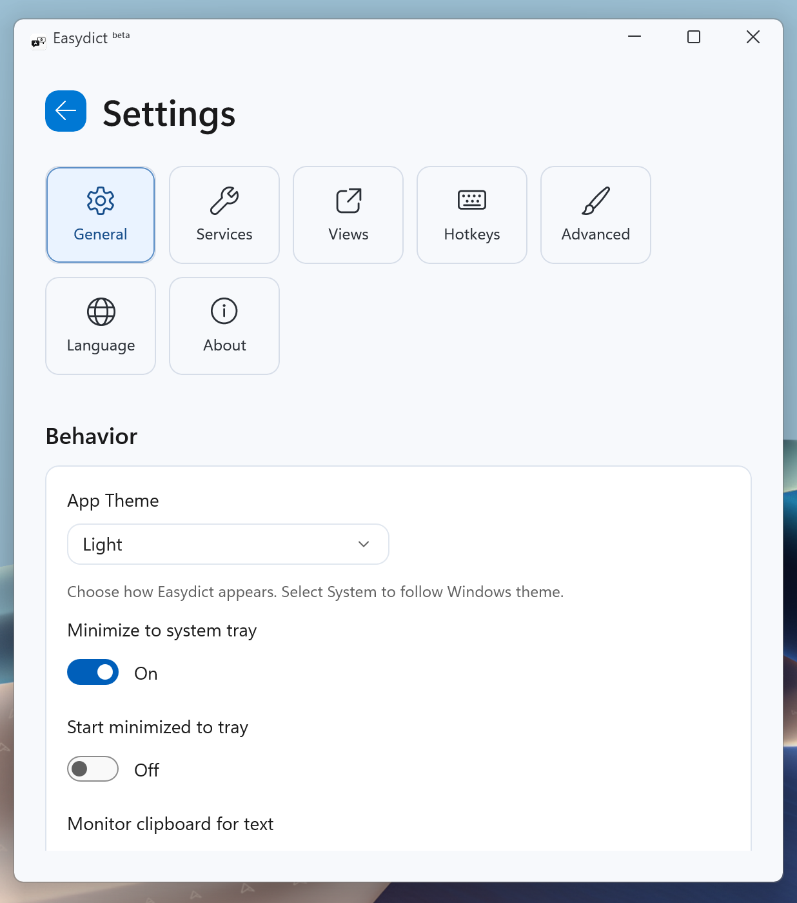 |
| Full translation interface | Main + Mini + Fixed windows with hotkey settings | Service configuration |

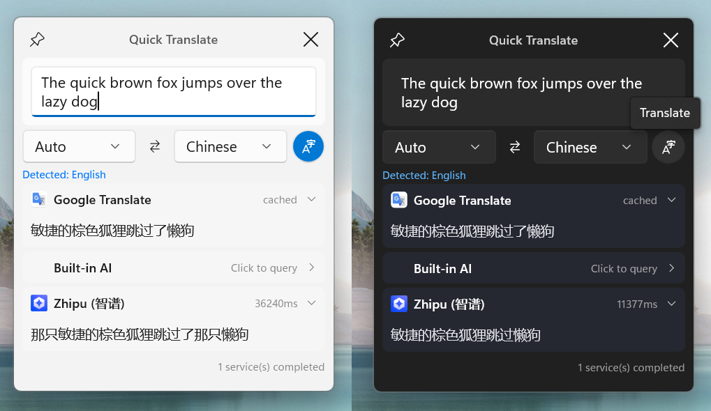

*Light & Dark Mode — Mini Window (Quick Translate)*

| Grammar Correction | Dictionary Mode | Long Document Translation |
|---|---|---|
| 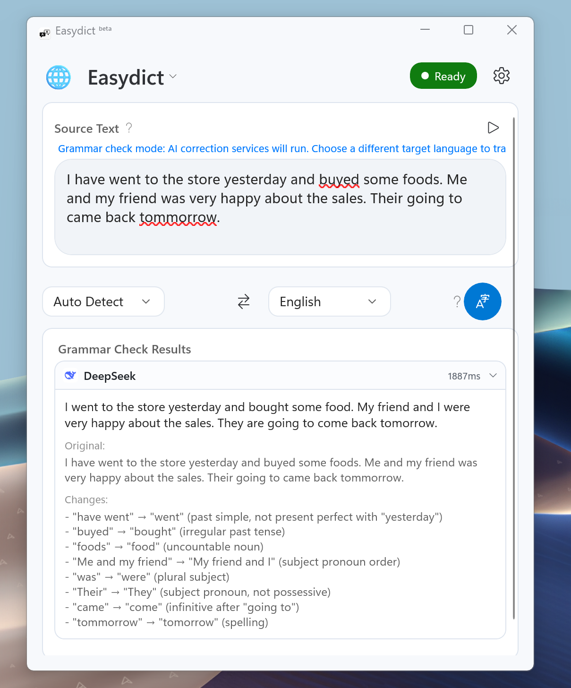 | 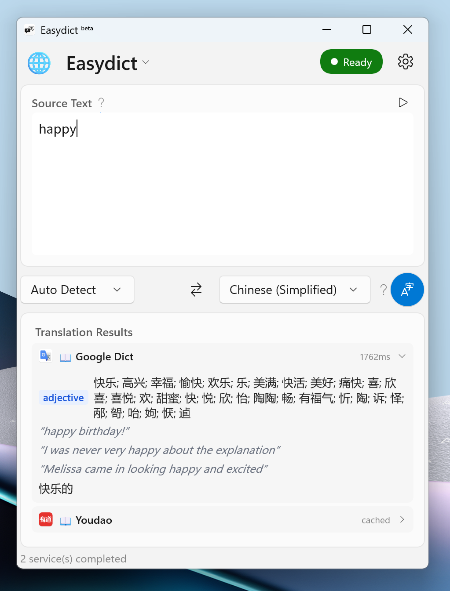 | 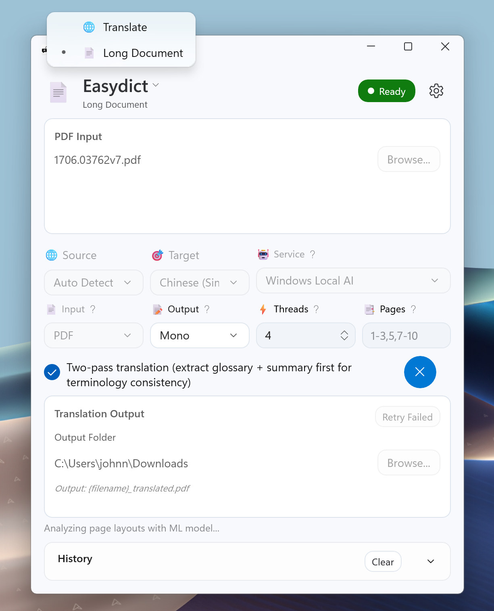 |
| AI-powered grammar correction | Word definitions, phonetics, and examples | PDF/Text/Markdown translation with progress |

| OCR Screenshot Translate | Mouse Selection Translate |
|---|---|
| 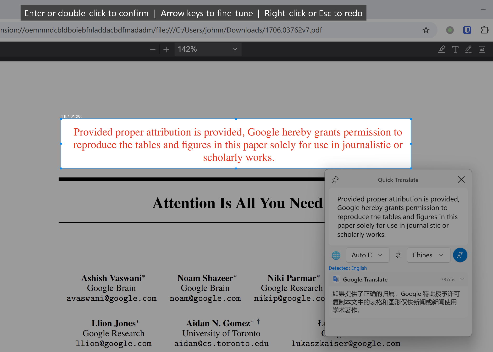 | 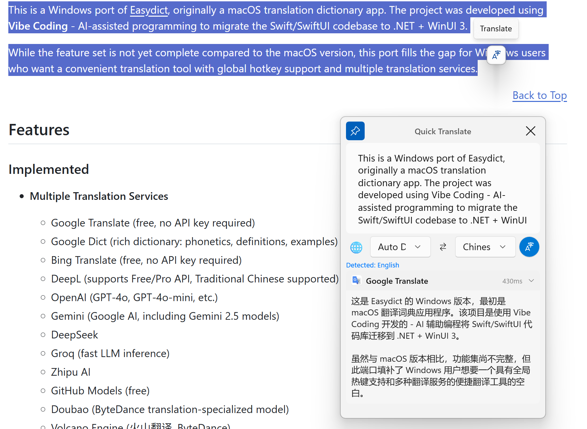 |
| Capture screen region → OCR → translate | Select text in any app → click to translate |

<p align="right"><a href="#table-of-contents">Back to Top</a></p>

## Features

-  **Copilot+ PC and local AI** — NPU-accelerated translation on Copilot+ PCs, with Foundry Local available on other Windows PCs.

- **OCR Screenshot Translate**
  - `Ctrl+Alt+S` — Capture a screen region, recognize the text, and translate it.
  - `Ctrl+Alt+Shift+S` — Recognize the text and copy it to the clipboard without translating.

- **Mouse Selection** — Select text in any app, then click the floating button to translate it.

- **Text Action** — Send selected text to a translation or search service from any window.

- **Bump plugin**

- **Labs** — New feature, start in Settings -> Labs.

- **Hover Word Lookup** — Hold `Ctrl` for at least 50 ms, then hover over a word to look it up.

- **Grammar Correction Mode**

- **AI Provider Profiles and**  **Mocktail**

- **Long Document Translation** - Translate PDF, plain text, and Markdown documents with ML-based layout detection, formula protection, parallel processing, bilingual output, and translation cache

- **Dictionary Mode** — Look up word definitions, phonetics, and examples.

- **MDX Dictionary** — Import MDict (`.mdx`) dictionaries for offline lookup.

- **Direction Mode**

- **MDX Direction**

- **Global Hotkeys**
  - `Ctrl+Alt+T` - Show/hide main window
  - `Ctrl+Alt+D` - Translate clipboard content
  - `Ctrl+Alt+M` - Show/hide mini window (copies selection and translates when available)
  - `Ctrl+Alt+F` - Show/hide fixed window
  - `Ctrl+Alt+S` - OCR screenshot translate
  - `Ctrl+Alt+Shift+S` - Silent OCR (copy recognized text to clipboard)
  - `Ctrl+Alt+Shift+M` - Toggle mini window visibility
  - `Ctrl+Alt+Shift+F` - Toggle fixed window visibility

- **Multiple Window Mode**
  - Main Window - Full translation interface
  - Mini Window - Compact floating window
  - Fixed Window - Persistent translation window

- **Streaming Translation** — See results as they arrive.

- **Dark Mode Theme**

- **TTS** — Read the source and translated text aloud.

- **Multi-language UI** — Use the interface in 15 languages.

- **40+ Languages** — Choose which languages appear in the source and target lists.

- **HTTP Proxy Support**

- **High DPI Support**

- **Multi-pair Translation Services**

<table>
  <tr>
    <td align="center"><br>Google Translate<br>Google Dictionary</td>
    <td align="center"><br>Bing</td>
    <td align="center"><br>DeepL</td>
    <td align="center"><br>Youdao</td>
    <td align="center"><br>OpenAI</td>
    <td align="center"><br>Gemini</td>
  </tr>
  <tr>
    <td align="center"><br>DeepSeek</td>
    <td align="center"><br>Groq</td>
    <td align="center"><br>Zhipu AI</td>
    <td align="center"><br>Kimi</td>
    <td align="center"><br>GitHub Models</td>
    <td align="center"><br>Doubao</td>
  </tr>
  <tr>
    <td align="center"><br>Volcano Engine</td>
    <td align="center"><br>Caiyun</td>
    <td align="center"><br>NiuTrans</td>
    <td align="center"><br>Linguee*</td>
    <td align="center"><br>Ollama</td>
    <td align="center"><br>Windows Local AI</td>
  </tr>
  <tr>
    <td align="center"><br>OpenRouter</td>
    <td align="center"><br>OrcaRouter</td>
    <td align="center"><br>Magpie</td>
    <td align="center"><br>Custom OpenAI</td>
    <td align="center"><br>Claude Code</td>
    <td align="center"><br>Codex</td>
  </tr>
</table>

*Linguee is currently unavailable.*

<p align="center"><a href="https://www.orcarouter.ai/ref/ref_a42265f998f62828c4d6"></a></p>

<p align="right"><a href="#table-of-contents">Back to Top</a></p>

## Installation

### System Requirements

- Windows 10 version 2004 (build 19041) or later
- x64 or ARM64 processor

### Install via winget

```powershell
winget install xiaocang.EasydictforWindows
```

### Download

Download from the [Releases](https://github.com/xiaocang/easydict_win32/releases) page.

#### Portable Version (Recommended)

**File:** `easydict_win32-vX.Y.Z-x64.zip`

- No installation required - extract and run
- No administrator privileges needed
- Self-contained (.NET runtime included)
- First run may trigger Windows SmartScreen warning - click "More info" → "Run anyway"

```powershell
# Extract and run
Expand-Archive easydict_win32-v1.0.0-x64.zip -DestinationPath Easydict
.\Easydict\Easydict.WinUI.exe
```

#### Verify Download (Optional)

Each release includes SHA256 checksums for verification.

```bash
# Linux/macOS/WSL
sha256sum -c checksums-x64.sha256 --ignore-missing

# PowerShell
$expected = (Get-Content checksums-x64.sha256 | Select-String "easydict_win32").ToString().Split()[0]
$actual = (Get-FileHash easydict_win32-v1.0.0-x64.zip -Algorithm SHA256).Hash.ToLower()
if ($expected -eq $actual) { "OK" } else { "FAILED" }
```

### Build from Source

```powershell
# Clone repository
git clone https://github.com/xiaocang/easydict_win32.git
cd easydict_win32/dotnet

# Build
dotnet build src/Easydict.WinUI/Easydict.WinUI.csproj -c Release

# Run
dotnet run --project src/Easydict.WinUI/Easydict.WinUI.csproj
```

<p align="right"><a href="#table-of-contents">Back to Top</a></p>

## Tech Stack

- **.NET** - Runtime framework
- **WinUI 3 (Windows App SDK)** - Modern Windows UI framework
- **C#** - Programming language
- **xUnit + FluentAssertions** - Unit testing

<p align="right"><a href="#table-of-contents">Back to Top</a></p>

## Translation Service Integration Tests

| Service | Protocol | Status | Notes |
|---------|----------|:------:|-------|
| Google Translate | REST | ✅ | Free, no API key |
| Bing Translate | REST | ✅ | Free, no API key |
| Youdao | REST | ✅ | Web + OpenAPI |
| OpenAI | OpenAI API | ✅ | |
| DeepSeek | OpenAI API | ✅ | |
| Gemini | Gemini API | ✅ | Custom SSE streaming |
| Zhipu AI | OpenAI API | — | Temporarily skipped: no API key configured |
| Kimi | OpenAI API | — | OpenAI-compatible (Moonshot AI), missing API key |
| Volcano Engine | REST | ✅ | HMAC-SHA256 signing |
| Groq | OpenAI API | ✅ | OpenAI-compatible |
| GitHub Models | OpenAI API | — | OpenAI-compatible, missing API key |
| Doubao | Custom SSE | — | Missing API key |
| DeepL | REST | ✅ | Free/Pro API |
| Caiyun | REST | — | Missing API key |
| NiuTrans | REST | ✅ | |
| Linguee | REST | — | Unavailable: upstream sample API domain no longer resolves; integration tests are skipped by default |
| Google Dict | REST | ✅ | |
| Ollama | OpenAI API | — | Requires local Ollama setup |
| Windows Local AI | Local runtime | ✅ | TranslationManager routing tested; real inference requires Phi Silica, Foundry Local, or OpenVINO model |
| OpenRouter | OpenAI API | — | OpenAI-compatible, missing API key |
| OrcaRouter | OpenAI API | ✅ | Integration coverage: streaming translation, non-streaming translation, and live model catalog (free models first) |
| Custom OpenAI | OpenAI API | — | OpenAI-compatible, user-defined endpoint |
| Magpie | OpenAI-compatible gateway | ✅ | 32 focused offline checks and isolated synthetic-gateway UI review; no real gateway or model call |
| Claude Code | Local CLI (stream-json) | — | Requires local `claude` CLI signed in |
| Codex | Local CLI (JSONL) | — | Requires local `codex` CLI signed in |

> Services marked **OpenAI API** extend `BaseOpenAIService` and share the same OpenAI-compatible implementation, so untested ones are expected to work similarly.

<p align="right"><a href="#table-of-contents">Back to Top</a></p>

## Support the Project

If Easydict for Windows is useful to you, please [give the repository a star on GitHub](https://github.com/xiaocang/easydict_win32). Your support helps more people discover the project and motivates its continued development.

<p align="right"><a href="#table-of-contents">Back to Top</a></p>

## Comparison with macOS Version

| Feature | macOS | Windows |
|---------|-------|---------|
| Translation Services | 25+ | 20 |
| OCR Screenshot Translation | Yes | Yes |
| TTS | Yes | Yes |
| Selection Translation | Yes | Yes |
| Hover Word Lookup | No | Yes (disabled by default) |
| Grammar Correction | No | Yes |
| Long Document Translation | No | Yes |
| Dictionary Mode | Yes | Yes |
| Window Types | 3 | 3 |
| Global Hotkeys | 10+ | 8 |
| LLM Streaming | Yes | Yes |
| Traditional Chinese | Yes | Yes |

<p align="right"><a href="#table-of-contents">Back to Top</a></p>

## Comparison with pdf2zh

[pdf2zh (PDFMathTranslate)](https://github.com/Byaidu/PDFMathTranslate) is a popular open-source PDF translation tool focused on scientific papers. The table below compares the long document translation capabilities of the two.

| Feature | pdf2zh | Easydict Win32 |
|---------|--------|----------------|
| Layout Detection | DocLayout-YOLO | ONNX (DocLayout-YOLO) / Vision LLM / Heuristic / Auto |
| Formula Protection | LaTeX preservation | Three-tier detection, multi-font glyph rendering, subscript/superscript handling |
| LLM Backends | OpenAI, Ollama, Azure OpenAI, etc. | OpenAI, Gemini, DeepSeek, Groq, Zhipu, Kimi, GitHub Models, Doubao, Ollama, Custom OpenAI-compatible |
| Document Context Pass | No | Yes — glossary + summary + preservation hints extracted before block translation for terminology consistency |
| Translation Cache | No | Yes — SQLite cache keyed by source hash + service + language pair |
| Parallel Translation | Limited | Configurable concurrency with retry + quality feedback |
| OCR Fallback (Scanned PDF) | No | Yes — Windows OCR for image-only pages |
| CJK Font Handling | Basic | Built-in CJK font resolver + TrueType CMAP parser + automatic font download |
| Page Range Selection | Yes | Yes (`1-3,5,7-10` or `all`) |
| UI | CLI + minimal GUI | Native WinUI 3 app with progress, preview, cancellation |
| Integration | Standalone | Part of full translation dictionary app (OCR, selection, hotkeys, streaming, etc.) |
| Platform | Cross-platform (Python) | Windows 10/11 (native .NET 8) |

<p align="right"><a href="#table-of-contents">Back to Top</a></p>

## License

GPL-3.0 - For learning and communication purposes only. License and copyright notice must be included when using source code.

<p align="right"><a href="#table-of-contents">Back to Top</a></p>

## Acknowledgements

- [Easydict](https://github.com/tisfeng/Easydict) - Original macOS version
- [Windows App SDK](https://github.com/microsoft/WindowsAppSDK) - WinUI 3 framework

---

*This project was developed using Vibe Coding, with AI-assisted programming by Claude (Anthropic).*
